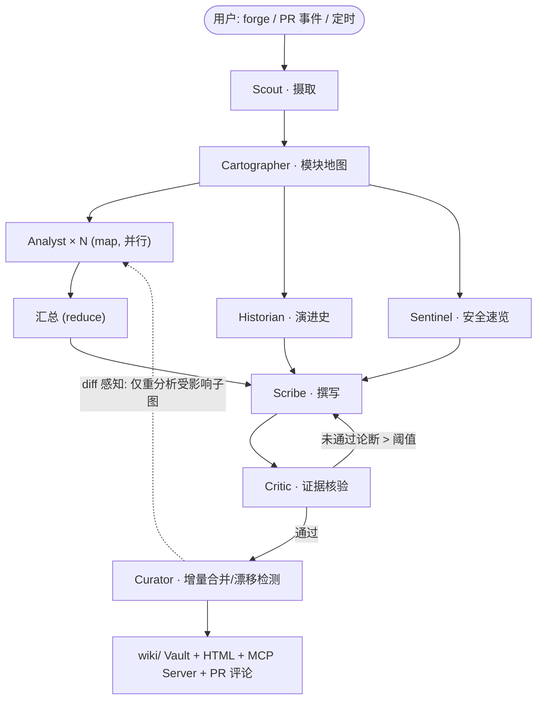

# WikiWright（维匠）开源项目策划报告

> **一句话定位**：一群 LangGraph 多智能体「匠人」，为任意代码库锻造一本**带证据引用、随 commit 增量更新、可通过 MCP 被任何 Agent 查询**的活维基（Living Wiki）。
>
> - 候选名：**WikiWright**（主推，已初查无明显同名项目）／RepoWright（备选）
> - 中文名：**维匠**
> - 英文 Slogan：*"An agent crew that forges — and keeps alive — the wiki your codebase deserves."*
> - 报告日期：2026-10-28 · 作者：项目发起人（个人开发者，纯 CPU 计算资源）

---

## 目录

1. [执行摘要](#1-执行摘要)
2. [调研综述：平台证据与数据](#2-调研综述平台证据与数据)
3. [目标人群与真实痛点](#3-目标人群与真实痛点)
4. [五个候选方案详细分析](#4-五个候选方案详细分析)
5. [评分矩阵与最终抉择](#5-评分矩阵与最终抉择)
6. [WikiWright 产品设计](#6-wikiwright-产品设计)
7. [多智能体技术架构（LangGraph）](#7-多智能体技术架构langgraph)
8. [仓库目录结构（干净整洁规范）](#8-仓库目录结构干净整洁规范)
9. [工程四性：可审阅 · 可管理 · 可靠 · 可持续](#9-工程四性可审阅--可管理--可靠--可持续)
10. [评测方案与 CCF-A 论文路线](#10-评测方案与-ccf-a-论文路线)
11. [GitHub 涨星运营策略](#11-github-涨星运营策略)
12. [商业模式与消费价值](#12-商业模式与消费价值)
13. [风险与对策](#13-风险与对策)
14. [30 / 60 / 90 天执行计划](#14-30--60--90-天执行计划)
15. [附录：调研来源汇总](#15-附录调研来源汇总)

---

## 1. 执行摘要

**结论先行**：在深度调研 GitHub / arXiv / Hugging Face / 魔搭 / CSDN 等平台后，从 5 个候选方向中，推荐启动 **WikiWright** —— 一个基于 **LangGraph + MCP 协议**的多模态多智能体「代码库活维基」引擎。

核心逻辑链：

1. **赛道被反复验证是涨星利器**：deepwiki-open（约 18k★）、OpenDeepWiki（约 4.9k★）、Repomix（约 27k★）、Mem0（约 65k★）——「把代码库变成知识」与「为 Agent 提供记忆/知识」两类项目在 2025–2026 年持续爆发。
2. **现有竞品全部停留在「一次性生成」**：没有项目做到「增量更新 + 证据引用可审计 + Agent 可消费（MCP）」三件事，这是清晰的技术空白，也是学术创新点（对标 ICSE/FSE/TOSEM 的软件文档方向）。
3. **完美契合约束**：目标用户就是每天泡在 GitHub 上的开发者；纯 CPU 可跑（LLM 走 API，嵌入/重排走 ONNX INT8）；个人可维护（核心 ≤ 8 个 Agent 角色，代码量可控）；天生适合做出惊艳的视觉演示（维基页面 + 架构图 + TUI 动画）。
4. **具备 AGI 时代风口属性**：MCP 生态 2026 年 10 月已超过 4.5 万个 server、月 SDK 下载近亿次。当 Agent 数量超过人类，「**由 Agent 维护、供 Agent 消费的知识库**」就是智能体时代的基础设施——WikiWright 的 MCP Server 正是这个故事。

**两个务必清醒的认知**（本报告不做虚假承诺）：

- 涨星没有保证，只能提高概率：靠「已被验证的需求 × 明显的差异化 × 极佳的第一印象 × 持续的发布节奏」。
- CCF-A 论文与 star 数无关，需要严格的评测（基准、基线、消融、人工研究）。本报告第 10 节给出了可执行的论文路线，但它是 v0.4 之后的第二阶段目标，不是第一个月的事。

---

## 2. 调研综述：平台证据与数据

> 调研时间：2026-10-28。所有 star 数为撰写时检索到的公开数据，会随时间变化，仅用于判断量级。

### 2.1 GitHub：智能体赛道的格局

| 证据 | 数据 | 对我们的启示 |
|---|---|---|
| LangGraph（langchain-ai） | ~39k★，MIT，低代码长流程编排的事实标准 | 技术栈选它 = 蹭最大社区红利，简历加分 |
| deepwiki-open（AsyncFuncAI） | ~18k★，开源版 DeepWiki，一次性生成 wiki | 「repo→wiki」需求被验证；但它是**快照式**的 |
| OpenDeepWiki（chasey-ai 等） | ~4.9k★（2025-05），NextJS+FastAPI+Haystack | 中文社区同样在追这个方向 |
| Repomix | ~27k★，把仓库打包喂给 LLM | 「仓库上下文」是刚需；可作我们的 ingestion 参考 |
| Mem0 | ~65.6k★（2026-09） | 「Agent 记忆/知识层」是超级涨星题材 |
| Langfuse | ~31.7k★ | AgentOps 赛道已是红海（巨头林立） |
| gpt-researcher | ~18–20k★ | Deep Research 赛道高度饱和 |
| OpenClaw | 2026 年现象级项目，9k→60k+★ | 2026 是「Agent 工具大年」，题材热度极高 |
| OpenCode | ~205k★，两周涨 1.8 万星；OSS Insight 称之为「coding agent 大战」 | **避免正面进入编码 Agent 战场**，做它旁边的知识层 |

### 2.2 MCP 生态（本项目「风口属性」的核心证据）

- 官方 MCP Registry 2026-10-17 收录 **45,188 个 server**，30 天内净增 12,549（+38%）；
- SDK 月下载：2026 Q1 约 9,700 万次，2026-07 官方博客称 Tier-1 SDK 接近**每月 5 亿次**；
- 2026-07-28 发布 **MCP v2 规范**（去掉会话握手、新增 MRTR 等）；
- 安全研究报告指出约 **82% 的 MCP 实现存在漏洞**——这为候选项 B（安全审计）提供了弹药，也促成了 WikiWright 内嵌的 Sentinel 角色。

**解读**：MCP 是 2026 年 Agent 世界的「HTTP」。任何产出知识的工具，只要同时是一个 MCP Server，就从「给人看的文档工具」升级为「智能体时代的知识基础设施」。

### 2.3 arXiv / 顶会：学术前沿与空白

| 论文/工作 | 内容 | 与本项目关系 |
|---|---|---|
| **DocAgent**（arXiv:2504.08725，ACL 2025 Demo，~53 引用） | 多智能体协作生成代码文档，拓扑序处理代码依赖 | **最近的先行工作**，但它做的是**函数/类级 docstring**，一次性、无证据 grounding、无 wiki 结构 |
| RepoAgent（OpenBMB） | 仓库级文档生成（docstring 向） | 同上，静态快照 |
| arXiv:2606.09852（2026） | 用 8 个 LLM 对比文档生成框架 | 说明评测基准是社区缺口 |
| AgentDojo（ETH Zurich） | Agent 攻防动态基准，结论「没有任何 agent 是完全鲁棒的」 | Agent 安全方向火热的证据（候选项 B 依据） |
| 「MCP 流量可被用作隐蔽 C2 信道」等 2026 研究 | MCP 安全新议题 | 候选项 B 的学术依据 |

**学术空白判断**：「**仓库级、增量式、证据可溯源**的文档/wiki 生成」没有完整占位的工作。DocAgent 停在 docstring，DeepWiki 停在快照。把「活文档（living documentation）」做成一个可评测的系统性问题，是 ICSE/FSE/TOSEM 喜欢的软件工程叙事（文档腐化/documentation drift 是经典痛点）。

### 2.4 中文社区（CSDN / 魔搭 / Gitee / 华为 / Trae）

- **魔搭 ModelScope**：阿里 AgentScope 1.0（2025-09 发布，开发者优先的多智能体框架）生态活跃；Qwen-Agent + 百炼 API 是国内主流接入口。→ 启示：模型层必须「OpenAI 兼容接口可插拔」，默认配置照顾 GLM/DeepSeek/Qwen。
- **CSDN**：智能体可视化编排类文章流量高（如开源 Agent 平台 openJiuwen 等）。→ 启示：中文首发技术长文是低成本获客渠道。
- **Gitee / 华为云社区 / Trae 社区**：适合做镜像同步、创空间（CPU 免费）部署 demo、插件化分发。
- 检索方法说明：本次桌面检索以 GitHub/arXiv/英文源为主，CSDN/魔搭为辅；立项后建议每周固定 30 分钟做一次系统性「竞品巡逻」（可用 ccf-literature-monitor 类流程固化）。

---

## 3. 目标人群与真实痛点

**核心用户画像**（完全满足「经常上 GitHub、能看到、会用到、愿意点 star」）：

| 人群 | 场景 | 痛点强度 |
|---|---|---|
| 开源贡献者/维护者 | 新人反复问「这个项目架构是什么」，README 三年没更新 | ★★★★★ |
| 接手陌生仓库的工程师 | onboarding 一周都在读代码，没有地图 | ★★★★★ |
| coding agent 用户（OpenCode/Claude Code/Cursor…） | 想让 Agent 理解大仓库，但每次都要重新喂数十万 token | ★★★★★ |
| 技术面试/求职者 | 快速吃透开源项目 internals | ★★★★ |
| 学生/研究者 | 找不到结构化的开源项目学习资料 | ★★★★ |

**一句话痛点**：*代码在变，文档已死；人读不动，Agent 喂不饱。*

WikiWright 的回答：文档不该是一次性生成的快照，而应该是**跟着 commit 一起呼吸的活物**；它写下的每句话都有 `[文件:行号]` 证据；它不只是给人看的，还是任何 Agent 都能即插即用的 MCP 知识源。

---

## 4. 五个候选方案详细分析

### 候选 A：WikiWright —— 多智能体「代码库活维基」引擎 ⭐推荐

- **概念**：`wikiwright forge owner/repo` 一条命令，8 个智能体协作产出带证据引用的 wiki；commit 到来时**增量更新**；同时暴露为 MCP Server。
- **竞品**：DeepWiki（Cognition，闭源 SaaS）、deepwiki-open（~18k★，快照式）、OpenDeepWiki、RepoAgent/DocAgent（学术，docstring 级）。
- **差异化三板斧**：① 增量活文档（diff 感知的模块依赖子图重分析）；② 证据 grounding + 可验证性评分（反幻觉，可审计）；③ MCP 原生（写给 Agent 看的知识）。
- **CPU 可行性**：LLM 全走 API（GLM/DeepSeek/Qwen/OpenAI 兼容），嵌入与重排用 ONNX INT8 CPU 模型，全程无需 GPU。
- **缺点**：赛道拥挤（但拥挤本身证明需求），需要靠差异化与执行力取胜。

### 候选 B：MCP-Guardian —— MCP 服务器安全审计多智能体

- **概念**：对任意 MCP server 做多智能体红队审计（注入、越权、数据外泄），产出漂亮的 HTML 安全报告 + 修复 PR。
- **依据**：82% 的 MCP 实现有漏洞；AgentDojo 等学术基准火热；注册表 4.5 万 server 且月增 38% ——审计对象在指数增长。
- **优点**：学术性最强（可冲 CCS/S&P/USENIX 风格），媒体喜欢安全故事。
- **缺点**：受众窄于 A（不是所有 GitHub 用户都写 MCP server）；演示视觉冲击弱于「一本书被锻造出来」；误报处理不当会砸口碑。
- **处置**：**不独立立项，作为 WikiWright 的 Sentinel 角色内嵌**（wiki 里附带依赖安全分析章节），验证需求后可拆分为姊妹项目。

### 候选 C：AgentOps-Lite —— 本地 Agent 观测与回放

- **概念**：轻量、本地优先的 Agent 追踪/评测/回放面板。
- **判定**：❌ 放弃。Langfuse（~31.7k★）、LangSmith、AgentOps 已把位子坐满，个人开发者正面强攻无胜算。

### 候选 D：DeepResearch 情报组 —— arXiv/GitHub 每日情报 wiki

- **概念**：监控主题，自动产出每日研究简报 wiki。
- **判定**：❌ 放弃为主。gpt-researcher 与各家「open deep research」克隆已泛滥；内容型产品难建立技术壁垒。**保留其 Historian 角色能力**（挖掘 commit/issue 历史）融进 WikiWright。

### 候选 E：本地优先的 Agent 记忆库

- **概念**：仓库/团队级、本地存储、MCP 暴露的记忆层。
- **判定**：⚠️ 备选。Mem0（~65k★）、Letta 正面碾压；但「仓库作用域记忆 + 完全本地」是缝隙。WikiWright 的实体图谱（wiki 交叉链接 + 引用索引）天然吸收了该能力。

---

## 5. 评分矩阵与最终抉择

评分 1–5（5 最佳；「竞争烈度」反向计分——越拥挤分越低）。

| 维度（权重） | A. WikiWright | B. MCP-Guardian | C. AgentOps | D. DeepResearch | E. 记忆库 |
|---|---:|---:|---:|---:|---:|
| 涨星潜力（25%） | 5 | 4 | 3 | 3 | 3.5 |
| 需求真实性（15%） | 5 | 4 | 3.5 | 3.5 | 4.5 |
| 竞争烈度-反向（10%） | 3 | 4.5 | 1.5 | 2 | 2 |
| CPU/个人可行性（15%） | 4.5 | 4 | 4 | 4.5 | 4 |
| CCF-A 创新空间（15%） | 4.5 | 5 | 2.5 | 3 | 3.5 |
| 商业价值（10%） | 4 | 4 | 3.5 | 3.5 | 4 |
| 视觉/演示冲击力（10%） | 5 | 3.5 | 3.5 | 4 | 3.5 |
| **加权总分** | **4.55** | **4.15** | **3.10** | **3.35** | **3.63** |

**抉择：A（WikiWright）**，并将 B 的安全能力、D 的历史挖掘、E 的知识图谱分别内嵌为 Sentinel / Historian / 实体图谱三个组件——一个核心产品吸收三个候选的精华。

---

## 6. WikiWright 产品设计

### 6.1 产品形态与核心体验

```text
$ pipx install wikiwright
$ wikiwright forge langchain-ai/langgraph

  ⚒ WikiWright · 匠人们开始锻造……
  ├─ Scout        正在克隆与打包仓库 (2,341 files)……
  ├─ Cartographer 正在绘制模块地图 (14 个模块, 依赖图完成)……
  ├─ Analyst ×4   并行深读核心模块……
  ├─ Historian    正在挖掘 1,203 个 commit 与 340 个 issue……
  ├─ Sentinel     正在审计 87 个依赖……
  ├─ Scribe       正在撰写 23 页 wiki……
  ├─ Critic       正在核验 412 条论断 → 397 条有证据, 15 条被标记 ⚠
  └─ Curator      正在生成 mermaid 架构图 ×5, 输出 → ./wiki/

  ✅ 完成 · Grounding Score 96.4% · 耗时 11 分钟 · 成本 $0.42
  📖 打开 wiki/index.html · 🔌 MCP server 已就绪: wikiwright serve
```

产出物（`wiki/` 目录，Obsidian 兼容的 Markdown Vault）：

- `index.md`：总览 + 项目卡片 + 快速上手；
- `architecture.md`：**mermaid 架构图 / C4 图 / 核心调用时序图**（由 AST 分析生成，非幻觉）；
- `modules/<name>.md`：每个模块一页——职责、入口、依赖、关键代码段（带 `[path:line]` 引用）；
- `history.md`：演进史（commit/issue 挖掘的高光叙事）；
- `security.md`：依赖与风险速览（Sentinel 产出）；
- `_evidence.jsonl`：**每条论断 → 证据（文件:行 + 代码片段）**的机器可读索引（可审计的核心）；
- 单文件自包含 `index.html`：可直接挂 GitHub Pages。

### 6.2 差异化功能（对竞品的「三板斧」+ 长期两张牌）

1. **增量更新（活文档）**：接入 GitHub Action，PR 合并后只重分析受影响模块（模块依赖图上的受影响子集），成本降一个数量级；检测到「文档漂移」在 PR 里留言。
2. **证据 Grounding（反幻觉）**：Critic 角色对 Scribe 的每条论断做证据核验（检索 + AST 锚点），无证据论断打 ⚠ 标记；每页挂 Grounding Score 徽章。**把「AI 文档不可信」这个最大质疑变成产品卖点。**
3. **MCP 原生**：`wikiwright serve` 启动 MCP server（`wiki.search` / `wiki.ask` / `wiki.get_diagram` / `wiki.changes`），Claude/Cursor/OpenCode 等任何 MCP 客户端即插即用——「一次锻造，所有 Agent 受益」。
4. 【v0.4+】**多仓库知识网格**：多个相关 repo（如 fastapi+starlette+uvicorn）的 wiki 互相链接成知识网格。
5. 【v0.4+】**多模态输入**：解析 README/issue 中的截图（VLM 可选开启），纳入 wiki；输出侧支持语音导览（Edge-TTS，纯 CPU）。

### 6.3 README 首屏设计（第一印象 = 转化率）

```markdown
# ⚒ WikiWright · 维匠
> An agent crew that forges — and keeps alive — the wiki your codebase deserves.

[60 秒 GIF：一条命令 → 一本带架构图、行号引用的维基在终端里被「锻造」出来]

pipx install wikiwright && wikiwright forge owner/repo

[badges: CI / License MIT / PyPI / Python 3.10+ / Grounding Score demo]
✨ 一群 LangGraph 智能体  ·  📚 证据可溯源（file:line）  ·  🔄 随 commit 增量更新  ·  🔌 MCP 原生  ·  🖥 纯 CPU

| 能力 | DeepWiki | deepwiki-open | RepoAgent | **WikiWright** |
|---|---|---|---|---|
| 开源/本地 | ❌ | ✅ | ✅ | ✅ |
| 增量更新（活文档） | ❌ | ❌ | ❌ | ✅ |
| 证据引用+核验 | ❌ | 部分 | ❌ | ✅ |
| MCP Server | ❌ | ❌ | ❌ | ✅ |
| 架构图（AST 级） | ✅ | ✅ | ❌ | ✅ |
```

视觉资产规划：AI 生成吉祥物（**猫头鹰工匠**：猫头鹰=智慧+夜猫子程序员，手持小锤锻造书本）、统一色板（锻铁深灰 + 炉火橙 + 羊皮纸米白）、全部截图统一主题字体。

---

## 7. 多智能体技术架构（LangGraph）

### 7.1 角色分工（8 个 Agent，各司其职）

| 角色 | 职责 | 模型档位 |
|---|---|---|
| **Scout**（侦察兵） | 浅克隆/GitHub API 拉取、打包（repomix 式）、分块、内容寻址存储 | 规则 + 本地小模型 |
| **Cartographer**（制图师） | AST/导入分析 → 模块地图 + 依赖图（增量的基础） | API 便宜档（GLM-4-Flash 级） |
| **Analyst × N**（分析师，map-reduce 并行） | 逐模块深读，产出结构化理解 JSON | API 主力档 |
| **Historian**（史官） | 挖掘 commit/issue/release，提炼演进叙事 | API 便宜档 |
| **Sentinel**（哨兵） | 依赖清单 + 风险速览（osv.dev 数据 + 解释） | 规则 + 便宜档 |
| **Scribe**（书记官） | 把结构化理解写成 wiki 页面（唯一执笔者） | API 主力档 |
| **Critic**（批评家） | 逐论断核验证据，未锚定即打 ⚠；Grounding Score | API 主力档（低温） |
| **Curator**（馆长） | diff → 受影响子图 → 增量合并与冲突消解 | 规则 + 便宜档 |

### 7.2 状态图（LangGraph Supervisor + Map-Reduce）



### 7.3 技术选型（「最先进」且纯 CPU）

| 层 | 选型 | 理由 |
|---|---|---|
| 编排 | **LangGraph 1.x**（StateGraph + SqliteSaver checkpoint） | 39k★ 事实标准；checkpoint 天然提供**全量回放/审计** |
| 工具抽象 | LangChain（仅用 I/O 与工具层，不绑全家桶） | 生态兼容 |
| LLM | 可插拔 OpenAI 兼容：GLM / DeepSeek / Qwen(百炼) / OpenAI；Ollama 本地 CPU（qwen2.5:1.5b 档做分类路由） | 纯 CPU、成本可控、国内外通吃 |
| 嵌入/重排 | bge-small / bge-reranker-base 的 **ONNX INT8** | 笔记本 CPU 秒级 |
| 解析 | tree-sitter（可选加速件）、GitHub REST/GraphQL API | AST 级架构图是差异点 |
| 存储 | SQLite（FTS5 全文）+ 内容寻址文件缓存 | 零部署、零污染、可 `git mv` |
| 接口 | Typer + Rich/Textual（CLI/TUI）· FastAPI（Web/MCP）· GitHub Action | 三端齐全 |
| MCP | 官方 Python SDK，遵循 **MCP v2** | 风口属性 |
| 工程 | uv、ruff、pytest、pre-commit、Conventional Commits、semantic-release、GitHub Actions CI（3.10–3.12 矩阵） | 「可管理」的落地件 |

---

## 8. 仓库目录结构（干净整洁规范）

```text
wikiwright/
├── .github/                  # CI/CD、issue/PR 模板、dependabot
│   ├── workflows/            # ci.yml / release.yml / docs.yml
│   └── ISSUE_TEMPLATE/
├── docs/                     # 架构文档、ADR 决策记录、路线图、本报告
├── src/wikiwright/           # 核心 Python 包（src 布局，防误导入）
│   ├── agents/               # 8 个角色，一人一文件 + prompts/ 目录
│   ├── graph/                # LangGraph 状态图、编排、checkpoint
│   ├── ingest/               # 克隆、打包、AST、分块、缓存
│   ├── wiki/                 # 渲染、mermaid、交叉链接、增量合并
│   ├── mcp/                  # MCP server（search/ask/get_diagram/changes）
│   ├── models/               # 模型路由：API / Ollama / 嵌入
│   ├── eval/                 # WikiBench 与指标
│   ├── cli/                  # typer 命令 + rich/textual TUI
│   └── web/                  # FastAPI 应用（本地 UI）
├── tests/                    # 单元 / 集成 / 金仓库回归（fixtures 用 git submodule）
├── examples/                 # 示例配置（wikiwright.toml）与样例输出
├── web/                      # 前端（Vite + 轻量框架，构建产物不进库）
├── .gitignore                # 严格排除 wiki/ 输出、缓存、构建产物
├── pyproject.toml            # 单一依赖真源（uv 管理）
├── README.md                 # 双语首屏（见 6.3）
├── CONTRIBUTING.md           # 贡献指南 + 架构导览 + good first issue 清单
├── CHANGELOG.md              # semantic-release 自动维护
├── CODE_OF_CONDUCT.md
└── LICENSE                   # MIT
```

**整洁铁律**：构建产物不入库（CI 校验）；生成输出默认进 `~/.cache` 或用户指定目录而非仓库内；一个模块一个职责；prompt 全部独立成 `prompts/*.md` 便于审阅迭代；每个 PR 必须过 ruff + pytest + 「目录卫生检查」脚本。

---

## 9. 工程四性：可审阅 · 可管理 · 可靠 · 可持续

| 性质 | 落地机制（不是口号） |
|---|---|
| **可审阅** | ① 每条 wiki 论断携带 `[file:line]` 证据，`_evidence.jsonl` 全量导出；② LangGraph checkpoint 完整保存每次运行的状态，`wikiwright replay <run-id>` 逐步回放任何一次生成；③ Critic 的核验日志（通过/驳回理由）随 wiki 一起发布 |
| **可管理** | `wikiwright.toml` 单一配置源（模型档位、角色开关、输出目标、成本上限）；`--budget` 硬性 token/费用上限；缓存与内容寻址存储使重跑幂等 |
| **可靠** | 金仓库回归测试（固定 3 个真实开源仓库的快照对比）；Grounding Score 低于阈值即整页告警；温度等确定性参数默认锁定；语义化版本 + CHANGELOG |
| **可持续** | 公开 ROADMAP.md 与里程碑；双周发版节奏；good first issue + 架构导览文档降低贡献门槛；ADR 记录所有重大决策；核心与 UI/插件分层，防止社区 PR 把架构改乱 |

---

## 10. 评测方案与 CCF-A 论文路线

### 10.1 WikiBench（先行构建，项目护城河兼论文基建）

- **语料**：按规模/语言/领域分层抽 100 个真实开源仓库（MIT/Apache 许可）；
- **标注**：每仓库 20–40 组「问题–标准答案–证据位置」（众包 + 交叉核验）；
- **指标**：
  - *Grounding Precision*：论断有真实证据的比例（人工抽检 + AST 锚点自动判）；
  - *QA Accuracy*：基于 wiki 回答问题的准确率（对比直接读代码的 LLM 基线）；
  - *Update Cost*：增量 vs 全量重跑的 token/时延比（预期降 5–10×）；
  - *Human Utility*：开发者 onboarding 盲测（Likert + 任务完成时间，N≥20）。

### 10.2 论文定位（诚实版）

- **工作题目（暂拟）**：*"Living Documentation: Diff-aware, Evidence-Grounded Wiki Generation for Software Repositories with Multi-Agent Collaboration"*
- **目标 venue**：ICSE / FSE（软工顶会，文档腐化是经典议题）→ 期刊版 TOSEM/TSE；WikiBench 可另投 NeurIPS Datasets & Benchmarks；ACL Demo 可作快速露面。
- **五点创新主张**（相对 DocAgent/RepoAgent/DeepWiki 系）：仓库级 wiki（非 docstring）；diff 感知增量维护（非快照）；证据 grounding 与可验证性评分；Agent 可消费（MCP）的文档形态；开放基准 WikiBench。
- **清醒提示**：novelty 要在 related work 里与 DocAgent（ACL'25 Demo）严格切割；人工研究和消融（去掉 Critic/Cartographer 的对照）是顶会门槛，安排在 v0.5 后的寒/暑假集中完成。**star 项目与顶会论文是两条并行的价值曲线，本项目两者兼顾但节奏分开。**

---

## 11. GitHub 涨星运营策略

### 11.1 上趋势榜的「组合拳」（按优先级）

1. **首屏即转化**：60 秒 GIF + 一行安装 + 对比表（见 6.3）；中英双语 README。
2. **蹭对关键词**：repo topics 打满 `deepwiki` `mcp` `langgraph` `agent` `documentation` `wiki` `code-review`——搜索「deepwiki open source alternative」的人群就是我们的精准流量。
3. **首发渠道矩阵**（按预期 ROI）：
   - 英文：Hacker News「Show HN」、r/LocalLLaMA + r/opensource、X 开源搬运大 V、awesome-mcp-servers / awesome-langgraph 列表 PR；
   - 中文：V2EX（分享创造节点）、掘金首页、知乎专栏、少数派；
   - 平台：Hugging Face **CPU Space 免费托管在线 demo**（`wikiwright forge` 60 秒体验版）、Gitee 镜像同步、魔搭创空间。
4. **节奏**：v0.1 自用 → v0.2 带 demo 静默上线收集 issue → **v0.3（增量 + MCP + Action 齐活）才打首发**；之后双周发版，每次 Release 配一条推文/帖。
5. **参与感**：公开 ROADMAP、`good first issue` 标签齐备、第一条社区 PR 24 小时内响应、贡献者墙上榜。
6. **视觉资产持续输出**：吉祥物表情包、架构图壁纸、star-history 徽章——开发者就吃这一套。

### 11.2 里程碑

`100★`（第一周，朋友圈+社群）→ `1k★`（Show HN / Reddit 首发成功）→ `5k★`（被 awesome-mcp-servers 等列表收录 + 中文社区发酵）→ `10k★`（大 V 转发 + 与 LangChain 社区联动）。

---

## 12. 商业模式与消费价值

| 层 | 形态 | 定价思路 |
|---|---|---|
| **开源核心**（MIT） | CLI + 本地 wiki + MCP server，自带 API key | 永久免费——这是 star 引擎，不是收入来源 |
| **托管版 Cloud** | GitHub App：装即用，PR 自动增量更新 wiki，免运维免 key | 按仓库订阅（个人 $9/repo/月，团队 $49 起）——「带一点消费价值」的落点 |
| **增值件** | 高级 wiki 主题模板、语音导览、多仓库知识网格 | 一次性或小额订阅 |
| **企业版** | 私有部署 + 审计导出 + SLA | 年费制（远期，勿早碰） |
| **生态分成** | 模型厂商合作返利（GLM/DeepSeek 新用户额度） | 覆盖 demo 成本 |

**原则**：开源核心足够好（才会涨星），云端省的是「运维与 token 管理」的钱（才有人付费）；绝不把 grounding 核心能力锁付费墙——那是口碑生命线。

---

## 13. 风险与对策

| 风险 | 概率 | 对策 |
|---|---|---|
| DeepWiki 官方或大厂加入同特性 | 中 | 速度 + 社区 + 差异化深耕（grounding 审计、论文背书）；保持 MIT 中立 |
| 幻觉翻车损害口碑 | 中 | Grounding-first 架构；无证据论断显式打 ⚠；demo 用金仓库 |
| API 成本失控 | 中 | 增量更新 + 内容寻址缓存 + 本地小模型分流 + `--budget` 硬上限 |
| 个人精力不足烂尾（最大真实风险） | 高 | **v0.1 范围铁律 ≤ 2 周**；砍功能不砍质量；双周小步发布制造正反馈 |
| 撞名/商标 | 低 | 已初查 WikiWright 无同名知名项目；发布前再查 GitHub org + PyPI + 商标库 |
| 许可合规 | 低 | 只分析许可兼容的开源仓库；输出物版权声明随源仓库 |

---

## 14. 30 / 60 / 90 天执行计划

### 第 1–30 天（v0.1 → v0.2：跑通「一次锻造」）

- 第 1 周：仓库初始化（本报告第 8 节结构 + CI 全套）；Scout/Cartographer/Analyst/Scribe 四角色最小闭环；输出单页 wiki + 1 张 mermaid 架构图。
- 第 2 周：Critic 证据核验 + Grounding Score；TUI 首屏动画；**自用吃透 2 个真实仓库**（dogfooding 是最好的测试）。
- 第 3–4 周：Historian/Sentinel/Curator 补齐八角色；HF Space CPU demo 上线；README 双语 + GIF。静默发布 v0.2，收集首批 issue。

### 第 31–60 天（v0.3：差异化三板斧齐活 → 首发冲刺）

- 增量更新（diff 感知子图重分析）+ GitHub Action + PR 漂移评论；
- MCP server（search/ask/get_diagram/changes 四工具）+ 接入 Cursor/Claude 实测录屏；
- **首发日**：Show HN + Reddit + V2EX + 掘金 + 知乎，同一天打出；话题预热（对比表长文）提前 3 天发。

### 第 61–90 天（v0.4 → 论文启动）

- WikiBench v0（30 仓库起步）；消融脚本；人工评测问卷框架；
- 多仓库知识网格 alpha；中文文档站（MkDocs Material）；
- 复盘增长数据，决定第二曲线（Sentinel 拆分独立项目 or 知识网格深化）。

---

## 15. 附录：调研来源汇总

**GitHub / 生态数据**

- [langchain-ai/langgraph](https://github.com/langchain-ai/langgraph) · [awesome-LangGraph 汇总](https://github.com/vonzosten/awesome-LangGraph)
- [AsyncFuncAI/deepwiki-open](https://github.com/AsyncFuncAI/deepwiki-open) · [Repowise 对比文（~18k★ 数据）](https://repowise.dev/blog/comparisons/repowise-vs-deepwiki) · [syspirit 评测](https://syspirit.fr/en/blog/deepwiki-open)
- [chasey-ai/open-deepwiki](https://github.com/chasey-ai/open-deepwiki) · [知乎介绍（~4.9k★）](https://zhuanlan.zhihu.com/p/1911900488351331383)
- [2026 AI 开源仓库地图（Langfuse ~31.7k★、Repomix ~27k★ 等）](https://blog.stackademic.com/i-collected-1-000-ai-github-repositories-so-you-dont-have-to-621b3be94a17) · [Top 20 agent repos](https://fungies.io/top-20-github-repositories-ai-agent-frameworks-2026) · [34 项目地图](https://www.digitalapplied.com/blog/best-open-source-ai-agent-projects-github-2026)
- [Mem0 ~65.6k★ 对比数据（Atlan）](https://atlan.com) · [gpt-researcher](https://github.com/assafelovic/gpt-researcher) · [OpenCode 两周 +18k★ 分析](https://medium.com/@milesk_33/opencodes-january-surge-what-sparked-18-000-new-github-stars-in-two-weeks-7d904cd26844)

**MCP 生态**

- [MCP 采用统计 2026（注册表 45,188 servers 等）](https://www.digitalapplied.com/blog/mcp-adoption-statistics-2026-model-context-protocol) · [gravity.fast 统计](https://gravity.fast/data/mcp-adoption-statistics) · [官方博客 2026-07-28 v2 规范](https://blog.modelcontextprotocol.io/posts/2026-07-28) · [企业 MCP 指南（82% 漏洞率出处之一）](https://theagentics.co/insights/the-enterprise-mcp-guide-2026) · [DevOps.com 分析](https://devops.com/how-model-context-protocol-mcp-is-fueling-the-next-era-of-developer-productivity)

**学术**

- [DocAgent（arXiv:2504.08725，ACL 2025 Demo）](https://arxiv.org/abs/2504.08725) · [RepoAgent（OpenBMB）](https://github.com/openbmb/repoagent) · [文档生成框架对比（arXiv:2606.09852）](https://arxiv.org/abs/2606.09852) · [AgentDojo（ETH）](https://github.com/ethz-spylab/agentdojo) · [Agent Security Map](https://guptadeepak.com/agent-security/red-teaming)

**中文社区**

- [AgentScope 1.0 报道（iheima）](https://www.iheima.com/article-389241.html) · [163 报道](https://www.163.com/dy/article/K8F0B3FR0519D45U.html) · [Qwen-Agent 生态解析（知乎）](https://zhuanlan.zhihu.com/p/2081732725027890805) · [CSDN 可视化 Agent 平台文](https://blog.csdn.net/2301_77888392/article/details/158651855)

---

*本报告为 WikiWright 立项策划书。下一步行动：按第 14 节第 1 周计划初始化仓库。*
